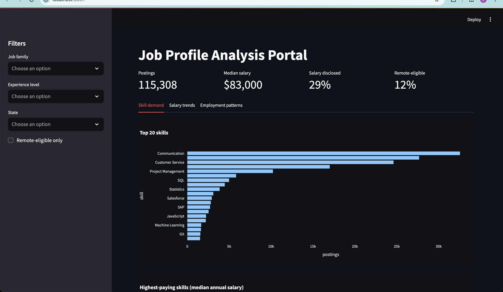
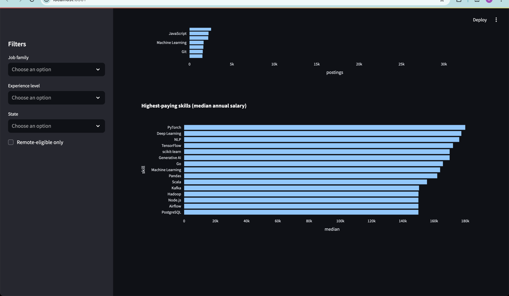
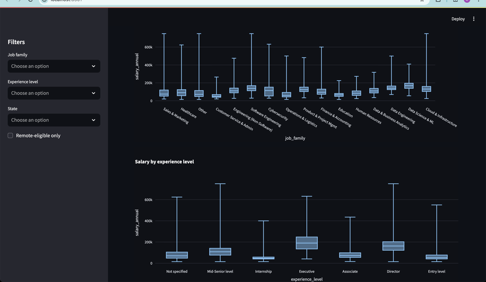
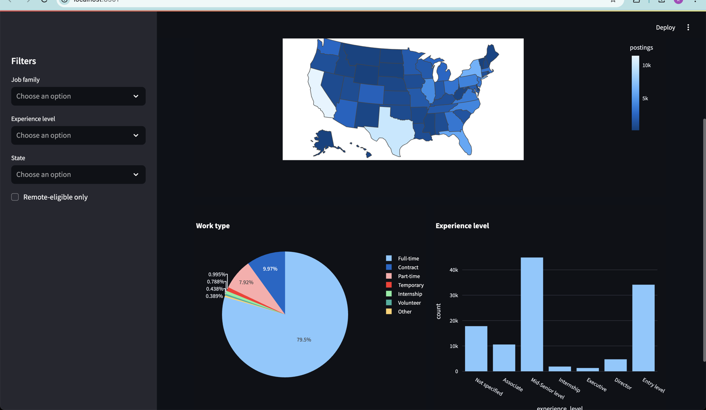

# Job Profile Analysis Portal

An end-to-end analytics project on the job market, in two parts:

1. **Live Federal Data & Tech Job Market** — an automated pipeline that pulls every open
   federal data, analytics and IT job from the official **USAJOBS API each morning**,
   tracks new and closed postings, salaries and **skill demand over time**, and serves a
   live dashboard.
2. **LinkedIn job-postings ETL** — turns **120K+ raw LinkedIn postings** into a clean
   star-schema data model and a portal for salary trends, skill demand and employment patterns.

**Stack:** Python (pandas) · REST APIs · ETL · GitHub Actions · Streamlit + Plotly · Power BI (DAX) · AWS S3 / Azure Blob Storage

---

## 1. Live Federal Data & Tech Job Market

**🔴 Live dashboard: [federal-tech-jobs-live.streamlit.app](https://federal-tech-jobs-live.streamlit.app)** — refreshed automatically every morning.

On its first run (Nov 20, 2026) the pipeline collected **823 open postings** across 10 federal data and tech job series, with a median starting salary of **$102,415**.

```
 USAJOBS Search API (official, data.usajobs.gov)
   10 job series: IT, data science, statistics, CS, operations research, economics, ...
                 │  every day 06:23 ET — GitHub Actions (.github/workflows/daily_ingest.yml)
                 ▼
 jobportal/live/usajobs.py   page through all open postings (500/page), flatten JSON,
                             annualise pay, flag remote/telework, extract 50+ skills
                 ▼
 jobportal/live/store.py     merge with history (first_seen / last_seen) → new & closed
                             postings, daily metrics, daily skill shares (idempotent reruns)
                 ▼
 data/live/*.csv  committed back to the repo  →  app/live_app.py (Streamlit dashboard)
```

| File | Grain |
|---|---|
| `data/live/postings.csv` | one row per announcement ever seen, with `first_seen` / `last_seen` |
| `data/live/daily_metrics.csv` | one row per day: open, new, closed, median salary, remote & telework share |
| `data/live/daily_skills.csv` | one row per day × skill: open postings mentioning it, share |

**Dashboard:** open / new / closed postings, median salary, remote share, top skills and
their change in share over the last 30 days, skill trend lines, top hiring agencies, job
series, states, and a table of today's new postings with links.

**Why files in Git instead of a database?** The data is small (a few thousand postings),
public, and versioned for free: every daily snapshot is a commit, so the history is
auditable and the dashboard can be hosted for free on Streamlit Community Cloud.

### Run it yourself

1. Get a free API key at [developer.usajobs.gov/apirequest](https://developer.usajobs.gov/apirequest/).
2. Locally: put `USAJOBS_API_KEY=...` and `USAJOBS_EMAIL=...` in a `.env` file, then
   ```bash
   python -m jobportal.live.ingest      # writes data/live/*.csv
   streamlit run app/live_app.py
   ```
3. Daily automation: in GitHub go to **Settings → Secrets and variables → Actions** and add
   `USAJOBS_API_KEY` and `USAJOBS_EMAIL`. The workflow then runs every morning (or from the
   **Actions** tab → *Daily USAJOBS ingest* → *Run workflow*).

---

## 2. LinkedIn job-postings ETL

---

### Architecture

```
 Kaggle LinkedIn postings (CSV)  ─┐
 local disk / s3:// / abfs://      │
                                   ▼
 ┌──────────── ETL pipeline (src/jobportal) ─────────────┐
 │ extract.py   read only needed columns, local or cloud │
 │ quality.py   data-quality scorecard (before)          │
 │ transform.py clean titles · dedupe re-posts ·         │
 │              annualise salaries · parse locations ·   │
 │              infer experience & work type ·           │
 │              job-family taxonomy · skill extraction   │
 │ quality.py   data-quality scorecard (after)           │
 │ load.py      star schema → CSV/Parquet → S3 / Azure   │
 │ insights.py  workforce & career insights + charts     │
 └───────────────────────────────────────────────────────┘
                   │                          │
                   ▼                          ▼
      Power BI report (powerbi/)    Streamlit portal (app/)
```

### Star schema (`data/processed/`)

| Table | Grain |
|---|---|
| `fact_job_postings` | one row per unique posting: salary (annualised), level, work type, remote flag, views, applies, skill count |
| `dim_company` · `dim_location` · `dim_job_family` · `dim_date` | descriptive dimensions |
| `dim_skill` + `bridge_job_skill` | many-to-many posting ↔ skill (50+ technical and soft skills) |

### ETL details

| Step | What it does |
|---|---|
| De-duplication | Drops duplicate `job_id`s and re-posted jobs (same company + title + location, keeps the newest). |
| Title cleaning | Strips noise such as "(Remote)", "- URGENT HIRING", extra whitespace. |
| Salary normalisation | Converts hourly / weekly / monthly pay to annual, fixes swapped min/max, removes impossible values, keeps USD only, adds salary bands. |
| Location parsing | Extracts city and state from `"City, ST"`, `"City, State"` and state-only strings. |
| Enrichment | Infers missing experience level from the title and missing work type from title/description; maps titles to 15 job families; flags remote roles. |
| Skill extraction | Regex dictionary over title + description + skills text (`config.py`). |
| Data-quality scorecard | Uniqueness, completeness and validity checks on raw vs cleaned data → `reports/data_quality_report.md`. |

### Results

| Metric | Value |
|---|---|
| Raw postings ingested | **123,849** |
| Re-posted duplicates removed | **8,523** |
| Clean postings in model | **115,308** |
| Companies / locations | 24,423 / 8,335 |
| Skill mentions extracted | **177,417** across 55 skills (+192K LinkedIn skill-category tags) |
| Data-quality score (raw → cleaned) | **93.7% → 96.4%** |
| Median disclosed annual salary | $83,000 (29% of postings disclose pay) |
| Remote-eligible postings | 12% |
| Full pipeline runtime | ~3 minutes on a laptop |

**Key findings**
- The most requested skills are soft skills (communication, customer service, project
  management); the most requested technical skill is **SQL**.
- The **highest-paying skills** are ML/AI-related: PyTorch, deep learning, NLP, TensorFlow,
  scikit-learn and generative AI, all with medians around $150K–$180K.
- **Data Science & ML** and **Data Engineering** have the highest median salaries of all job families.
- California and Texas have the most postings.

Full tables: [`reports/insights.md`](reports/insights.md) · quality checks:
[`reports/data_quality_report.md`](reports/data_quality_report.md)

### Dashboard

**Overview & skill demand**


**Highest-paying skills**


**Salary trends by job family and experience level**


**Employment patterns: postings by state, work type, experience level**


## Quick start

```bash
git clone https://github.com/<your-username>/job-profile-analysis-portal.git
cd job-profile-analysis-portal
python -m venv .venv && source .venv/bin/activate       # Windows: .venv\Scripts\activate
pip install -r requirements.txt
pip install -e .

# 1. download the data -> data/raw/postings.csv  (see data/README.md)
# 2. run the ETL
python -m jobportal.pipeline --postings data/raw/postings.csv
# 3. open the interactive portal
streamlit run app/streamlit_app.py
# 4. build the Power BI report: powerbi/POWERBI_GUIDE.md

pytest -q
```

### Cloud options

```bash
# read from / write to AWS S3   (pip install boto3 s3fs ; aws configure)
python -m jobportal.pipeline --postings s3://my-bucket/raw/postings.csv --upload-s3 my-bucket

# write to Azure Blob Storage   (pip install azure-storage-blob)
export AZURE_STORAGE_CONNECTION_STRING="..."
python -m jobportal.pipeline --postings data/raw/postings.csv --upload-azure my-container
```

Power BI can then connect directly to the S3 / Azure container.

## Project structure

```
job-profile-analysis-portal/
├── .github/workflows/          # daily_ingest.yml - scheduled USAJOBS ingest
├── app/live_app.py             # live federal jobs dashboard
├── app/streamlit_app.py        # LinkedIn ETL portal
├── data/live/                  # daily USAJOBS history (committed by GitHub Actions)
├── data/raw/                   # Kaggle CSVs (git-ignored)
├── data/processed/             # star-schema output (git-ignored)
├── powerbi/                    # POWERBI_GUIDE.md, measures.dax, .pbix, screenshots
├── reports/                    # data-quality report, insights, charts
├── scripts/make_sample_data.py # synthetic messy data for smoke tests
├── src/jobportal/              # extract · quality · transform · load · insights · pipeline
│   └── live/                   # usajobs.py (API client + parser) · store.py · ingest.py
└── tests/                      # test_etl.py, test_live.py (+ sample USAJOBS responses)
```

## Dataset

[LinkedIn Job Postings (2023–2024)](https://www.kaggle.com/datasets/arshkon/linkedin-job-postings)
on Kaggle — ~124K postings. `postings.csv` is required; `jobs/job_skills.csv` and
`mappings/skills.csv` are optional and add LinkedIn's own skill-category tags.
